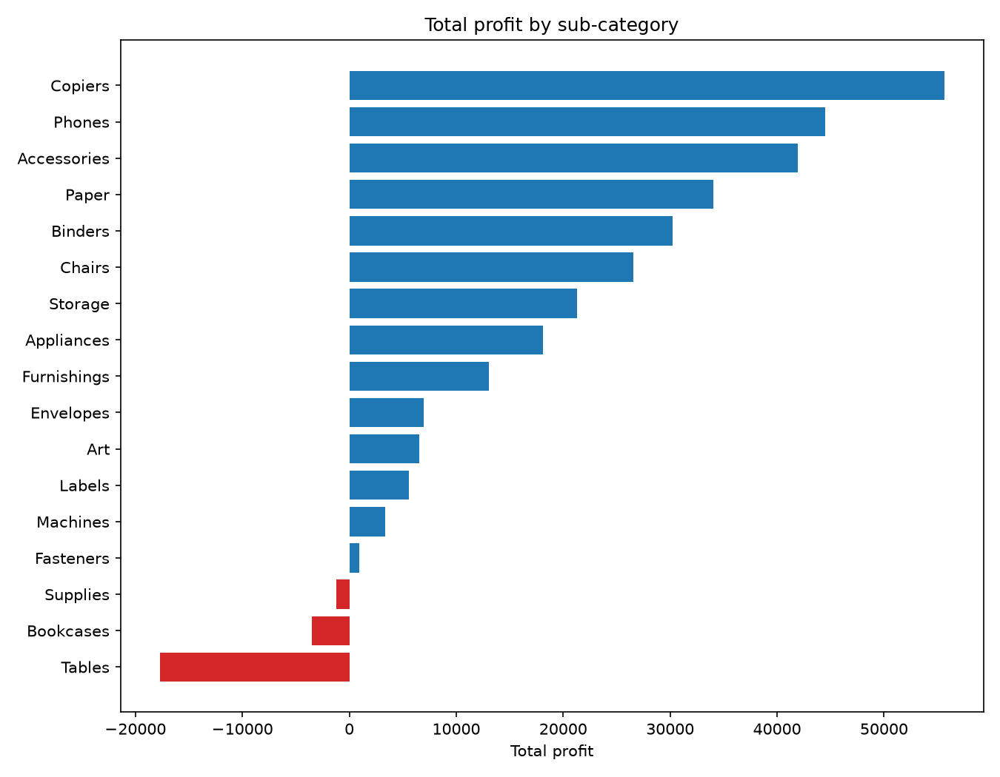
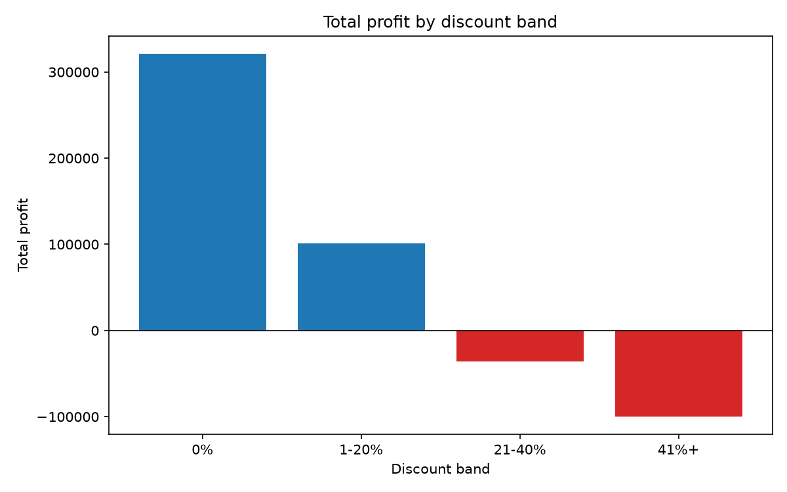

# Superstore Retail Analysis

## Question
Which products and months drive the most sales, and where is the business losing money?

## Dataset
Superstore Sales dataset (Kaggle): 9,994 order lines with sales, quantity, discount and profit across categories and regions.

## Tools
- SQL Server (SSMS) for loading, cleaning and analysis
- Python / pandas / matplotlib for exploration and charts
- Power BI for a dashboard (coming next)
- Git and GitHub for version control

## Key Findings
1. **Three sub-categories lose money:** Tables, Bookcases and Supplies have negative total profit.
2. **Discounts above 20% turn profit negative.** Order lines with discounts up to 20% are profitable, but the 21-40% band loses about 35,800 and the 41%+ band loses about 99,600. Together these bands are only about 14% of order lines (1,393 of 9,994) yet lose roughly 135,000.
3. **Discounting doesn't explain everything.** Tables (26.1% average discount) and Bookcases (21.1%) are heavily discounted, but Supplies (7.7%) loses money with a low discount, so something else is going on there.
4. **Sales and profit peak in September, November and December** (all years combined). November has the highest sales but a lower profit margin than December or September.
5. **Top sellers aren't always profitable.** The Canon imageCLASS 2200 Advanced Copier is the #1 product by sales, but three of the top 10 products lose money: the Cisco TelePresence System EX90, the GBC DocuBind P400 and the High Speed Automatic Electric Letter Opener.

## Charts

## Project Structure
- `data/` raw dataset
- `sql/` numbered scripts, run in order:
  - `01_create_and_load.sql` creates the database and loads the CSV
  - `02_clean_dates.sql` converts text dates into real dates
  - `03_profit_analysis.sql` loss-making sub-categories and discount bands
  - `04_monthly_sales.sql` sales and profit by month
  - `05_top_products.sql` top 10 products by sales
- `python/` pandas scripts that reproduce findings as charts:
  - `01_explore.py` loads the CSV and checks its shape and columns
  - `02_profit_chart.py` profit by sub-category
  - `03_discount_chart.py` profit by discount band
- `images/` charts produced by the Python scripts

## Status
SQL analysis and Python charts complete. Power BI dashboard in progress.